<div align="center">

# Kinematic

### One free tool for 3D, images, video, simulation, live shows and sound.

macOS · Windows · Linux · Raspberry Pi. No account, no license key.

[**macOS**](https://get.kinematic.org/Kinematic-0.5.0.dmg) · [**Windows**](https://get.kinematic.org/Kinematic-0.5.0-windows-x86_64-setup.exe) · [**Linux**](https://get.kinematic.org/kinematic_0.5.0-0_amd64.deb) · [**Raspberry Pi**](https://get.kinematic.org/kinematic_0.5.0-0_arm64.deb) · [All downloads](https://kinematic.org/download/)

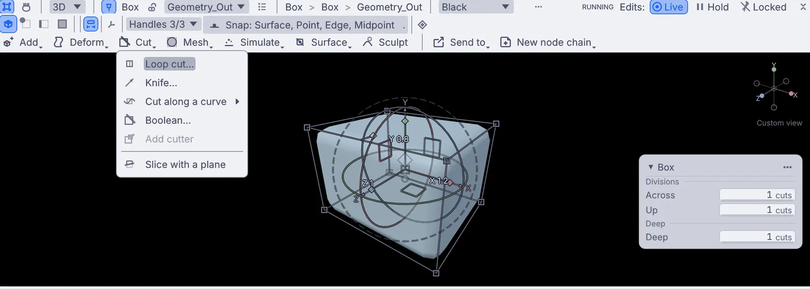<br>
<sub>The viewport with the Cut menu open on a box. Loop cut, knife, boolean and slice each add a node to the graph.</sub>

</div>

---

Kinematic is a full DCC. Model, sculpt, rig and render. Edit photos and cut video. Simulate liquids, fire and cloth. Run projectors and lights for a show. Build synths and play them.

You can work two ways. Use a tool in the viewport and its node lands on the canvas, so every edit stays open to change. Or start on the canvas and wire it yourself. It works the same way for photos, video, sims, shows, sound and code.

**2,225** node types · **400+** demos in the app · **1,500+** lighting fixture profiles · **$0** for everyone

## Download

This repository holds the binary releases. Every platform is on 0.5.0.

| Platform | Version | Download | Size |
|---|---|---|---|
| macOS, Apple Silicon | 0.5.0 | [Kinematic-0.5.0.dmg](https://get.kinematic.org/Kinematic-0.5.0.dmg) | 603 MB |
| Windows, x64 | 0.5.0 | [Kinematic-0.5.0-windows-x86_64-setup.exe](https://get.kinematic.org/Kinematic-0.5.0-windows-x86_64-setup.exe) | 1.07 GB |
| Linux, x86_64 (deb) | 0.5.0 | [kinematic_0.5.0-0_amd64.deb](https://get.kinematic.org/kinematic_0.5.0-0_amd64.deb) | 1.09 GB |
| Linux, x86_64 (tar.gz) | 0.5.0 | [kinematic-0.5.0-linux-x86_64.tar.gz](https://get.kinematic.org/kinematic-0.5.0-linux-x86_64.tar.gz) | 1.37 GB |
| Linux, x86_64 (snap) | 0.5.0 | [Snap Store](https://snapcraft.io/kinematic) | |
| Raspberry Pi 5, arm64 (deb), experimental | 0.5.0 | [kinematic_0.5.0-0_arm64.deb](https://get.kinematic.org/kinematic_0.5.0-0_arm64.deb) | 521 MB |
| Raspberry Pi 5, arm64 (tar.gz), experimental | 0.5.0 | [kinematic-0.5.0-linux-aarch64.tar.gz](https://get.kinematic.org/kinematic-0.5.0-linux-aarch64.tar.gz) | 643 MB |

The download is the whole app. Free, even for commercial use. No node limit, no resolution cap, no watermark. A .kin graph opens on every system Kinematic runs on.

### Install notes

**macOS.** macOS 12.3 or newer, on a Mac with Apple Silicon. Open the DMG and drag Kinematic to Applications. It is signed and notarized by Apple. If a camera picture stays black, allow camera access in System Settings, then restart Kinematic.

**Windows.** Windows 10 (version 1809 or newer) or Windows 11, 64-bit. Run the signed installer. Graphics run on Vulkan, which comes with your NVIDIA, AMD or Intel driver. Windows N editions need Microsoft's free Media Feature Pack first. The installer offers one firewall rule so Art-Net, sACN, OSC and NDI can reach the app; it goes when you uninstall.

**Linux.** Ubuntu 24.04 LTS or newer, 64-bit Intel or AMD, in a desktop session. Graphics run on Vulkan, on Mesa or NVIDIA drivers.

- The .deb is the full install, including NDI, Orbbec depth cameras, CLAP, VST3 and LV2 plugins, Stream Deck and serial DMX: `sudo apt install ./kinematic_0.5.0-0_amd64.deb`
- The tar.gz needs no install. Unpack it and run `usr/bin/kinematic` from inside the `kinematic-0.5.0-linux-x86_64` folder.
- The snap is sandboxed: `sudo snap install kinematic`. Art-Net, sACN, MIDI, cameras, screen capture, sound and the GPU all work. For NDI, depth cameras, your own plugins, Stream Deck or serial DMX, take the .deb. The two can sit on one machine, and each keeps its own settings.

**Raspberry Pi (experimental).** Raspberry Pi 5 with 64-bit Raspberry Pi OS. Built and tested on a Pi 5. Install the .deb the same way as on Linux, or unpack the tar.gz and run `usr/bin/kinematic` from the `kinematic-0.5.0-linux-aarch64` folder. 3D renders use a lighter mode on the Pi: up to 8 lights, simpler shadows, no environment lighting, and custom shader materials do not run. The first start takes longer while the graphics driver warms up. Test a show on the actual board before the doors open.

### Updating from OGEX

Kinematic was called OGEX until 0.5.0. If you used an older release:

- **macOS** asks for camera and microphone access again. Allow both to keep using cameras and sound input.
- **Windows** keeps the old entry in Installed apps. Remove it yourself from Windows Settings.
- **Your files.** Every graph you save from 0.5.0 on is a .kin file: plain text you can read, compare and keep in version control.

## Five ways in

Modelers and editors start in the viewport. Simulation, show and sound artists start on the canvas.

### [Create](https://kinematic.org/create/)

Model, sculpt, texture, rig, animate and render. Draw vectors and bring in scans. Pen pressure and tilt work in Sculpt, and every edit is a step you can reopen.

<table>
  <tr>
    <td width="33%"><a href="https://kinematic.org/create/model/">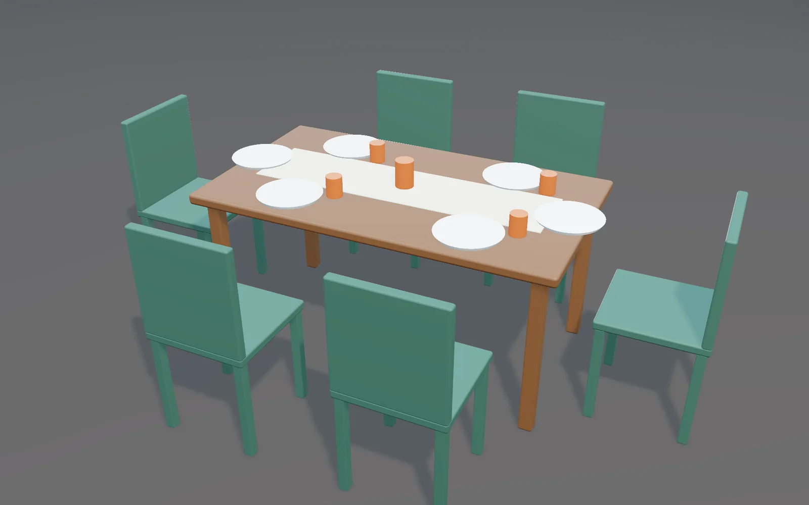</a></td>
    <td width="33%"><a href="https://kinematic.org/create/sculpt/">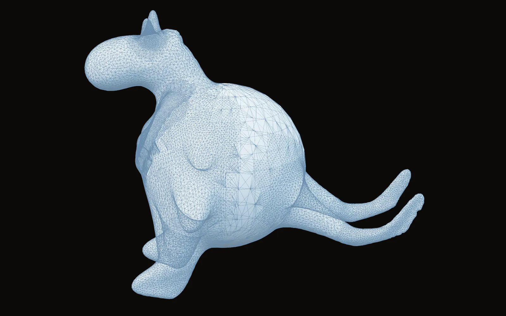</a></td>
    <td width="33%"><a href="https://kinematic.org/create/#rig">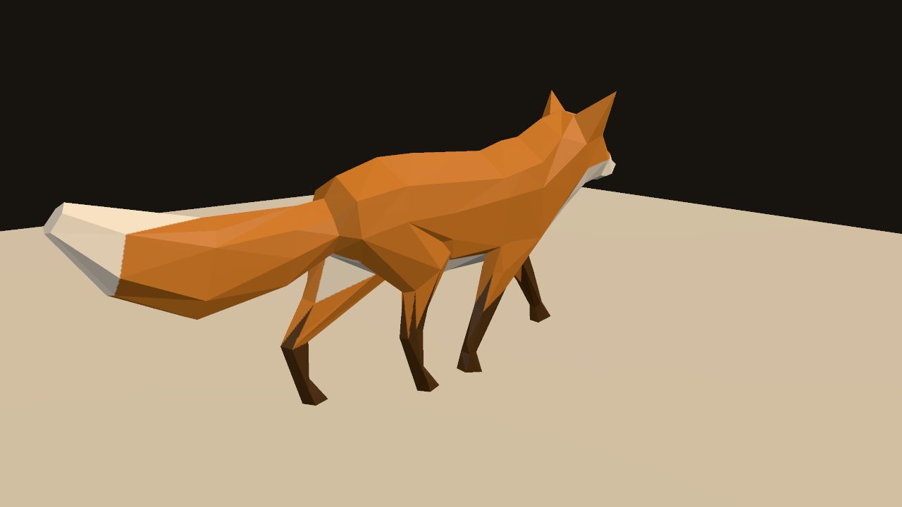</a></td>
  </tr>
  <tr>
    <td><sub>Chairs pulled up to a set table, modeled in the viewport.</sub></td>
    <td><sub>A creature pulled out of a ball. The mesh is dense only where the brush added detail.</sub></td>
    <td><sub>A rigged fox walking, live in the viewport. Click for the video.</sub></td>
  </tr>
</table>

### [Edit](https://kinematic.org/edit/)

Develop, grade, retouch and composite photos. Cut video. Shape MIDI. The image editor has 118 tools in six groups, and works the same on a photo, a video, a camera or an NDI feed.

<table>
  <tr>
    <td width="33%"><a href="https://kinematic.org/edit/">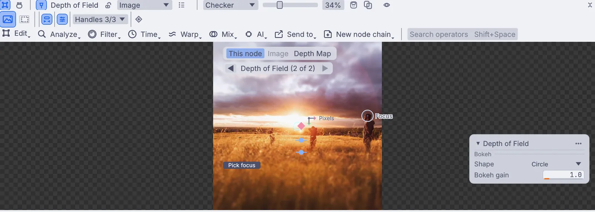</a></td>
    <td width="33%"><a href="https://kinematic.org/edit/color/">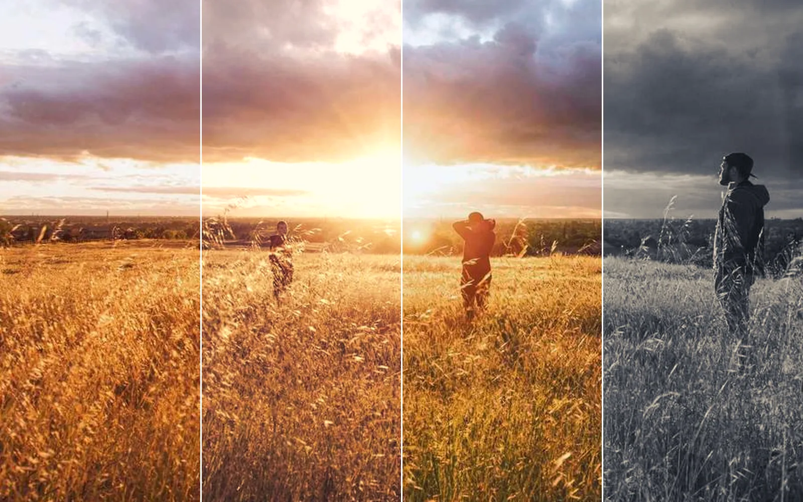</a></td>
    <td width="33%"><a href="https://kinematic.org/edit/video/">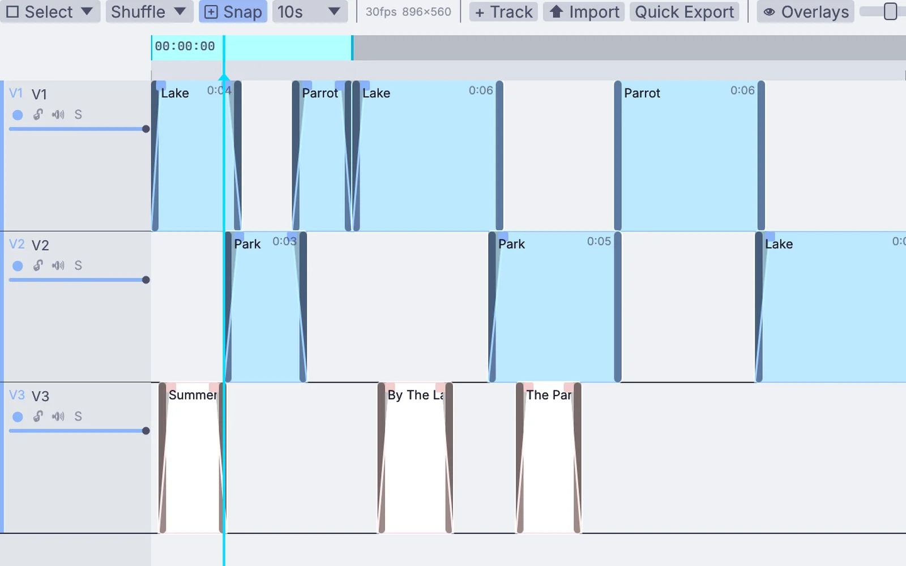</a></td>
  </tr>
  <tr>
    <td><sub>Depth of field in the image editor. Click the frame to set the focus.</sub></td>
    <td><sub>One sunset field in four looks: as shot, warm film, teal and silver.</sub></td>
    <td><sub>Clips on three video tracks in the timeline.</sub></td>
  </tr>
</table>

### [Simulate](https://kinematic.org/simulate/)

Liquids, fire, smoke, cloth, particles, rigid bodies and terrain. On the GPU, live. Scrub back through a simulation on the timeline.

<table>
  <tr>
    <td width="33%"><a href="https://kinematic.org/simulate/liquids/">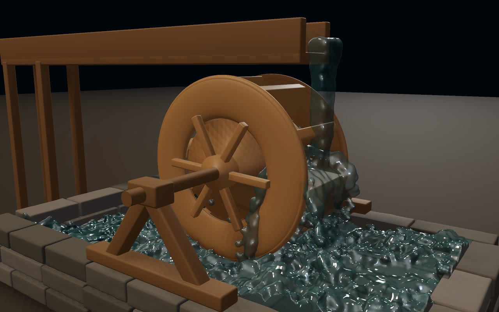</a></td>
    <td width="33%"><a href="https://kinematic.org/simulate/fire/">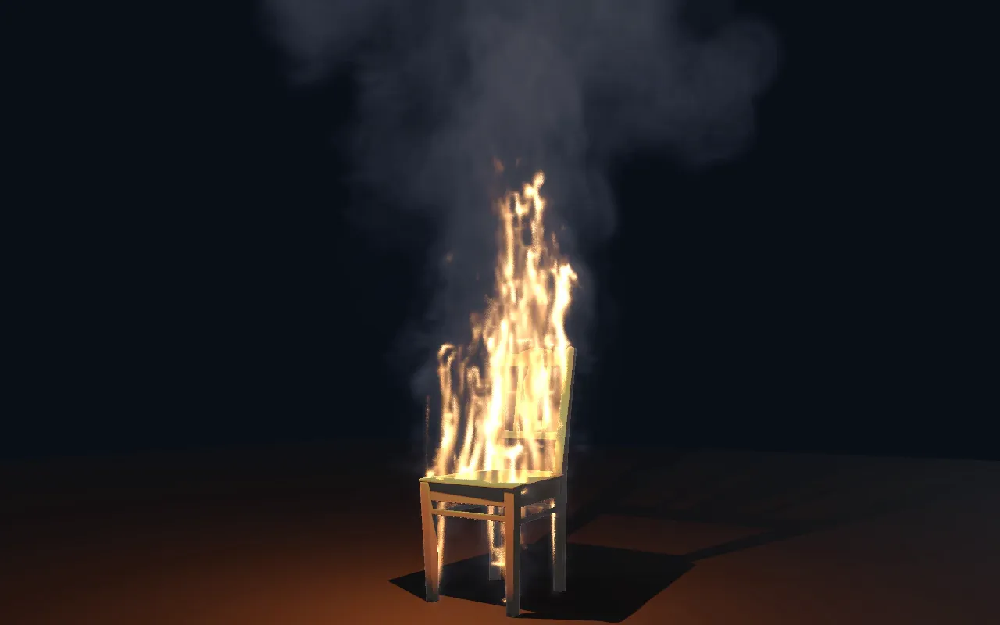</a></td>
    <td width="33%"><a href="https://kinematic.org/simulate/cloth/">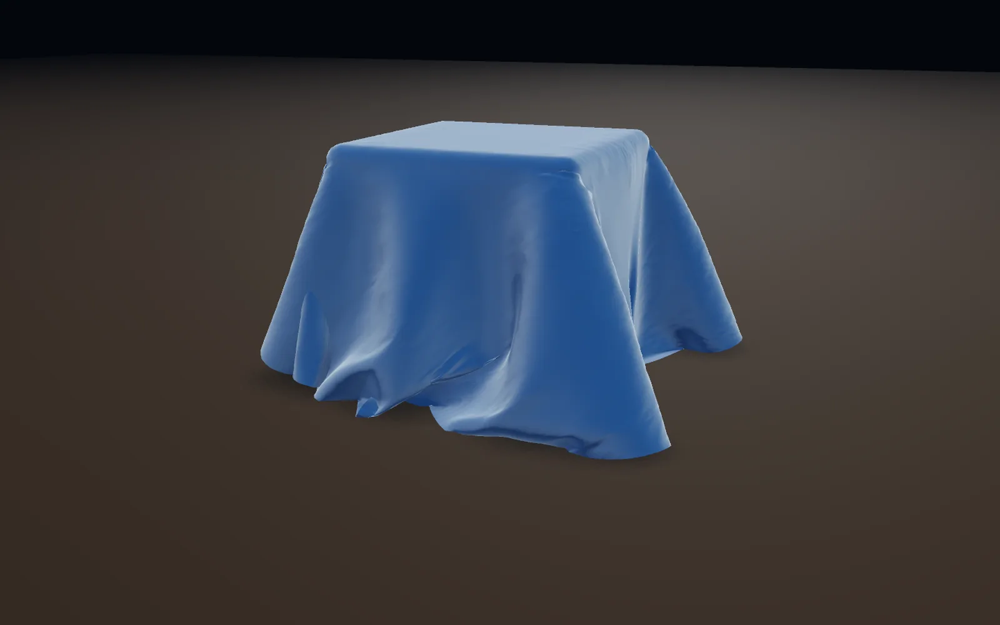</a></td>
  </tr>
  <tr>
    <td><sub>Water spilling off a wooden trough turns the paddle wheel. Click for the video.</sub></td>
    <td><sub>A wooden chair catching fire, smoke rolling over the top.</sub></td>
    <td><sub>A round cloth settled over a box in soft folds.</sub></td>
  </tr>
</table>

### [Perform](https://kinematic.org/perform/)

Projectors, lights, cameras and live video. Build the show, then run it. DMX, Art-Net and sACN, NDI and Syphon, and Perform mode hands the screen to the show.

<table>
  <tr>
    <td width="33%"><a href="https://kinematic.org/perform/projection/">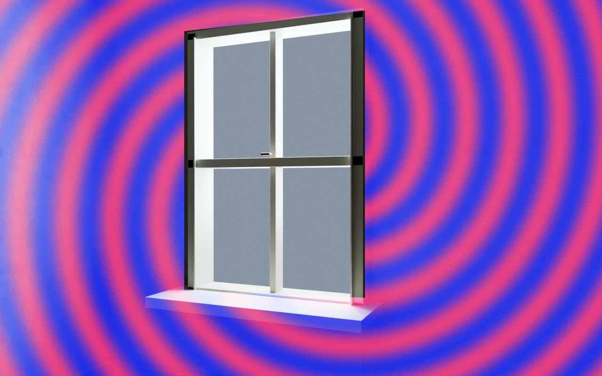</a></td>
    <td width="33%"><a href="https://kinematic.org/perform/lighting/">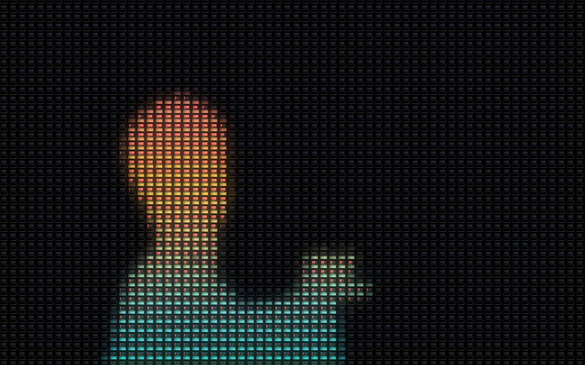</a></td>
    <td width="33%"><a href="https://kinematic.org/perform/show/">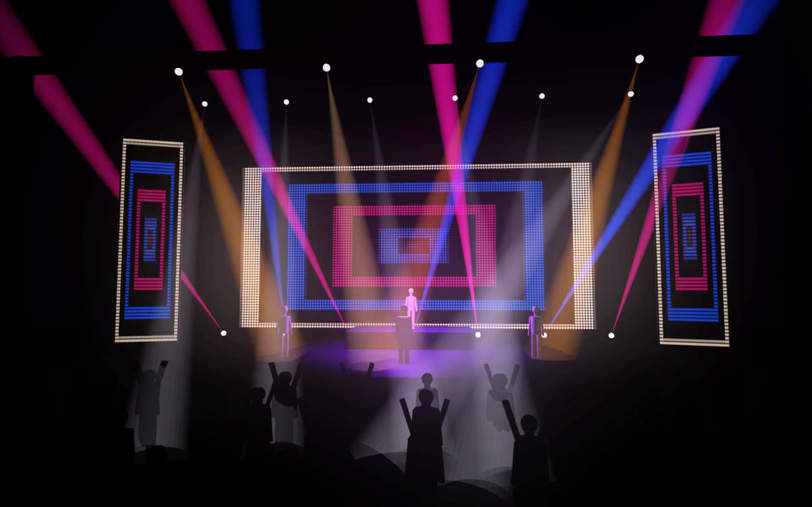</a></td>
  </tr>
  <tr>
    <td><sub>A spiral projected on a wall, the window cut out so no light hits the glass. Click for the video.</sub></td>
    <td><sub>A dancer clip driving a DMX pixel grid.</sub></td>
    <td><sub>Perform mode on a concert stage: an LED wall, beam fans and moving heads over the crowd. Click for the video.</sub></td>
  </tr>
</table>

### [Play](https://kinematic.org/play/)

Synths, samples, effects, MIDI and plugins. Then let the sound move the picture. Your CLAP and VST3 plugins run in the graph, and it works with Ableton Live.

<table>
  <tr>
    <td width="33%"><a href="https://kinematic.org/play/synths/">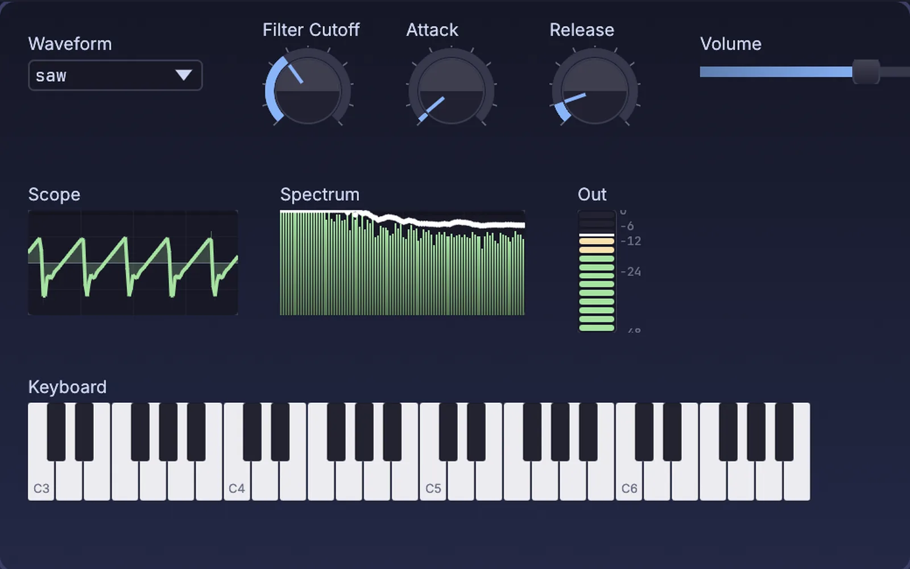</a></td>
    <td width="33%"><a href="https://kinematic.org/play/midi/">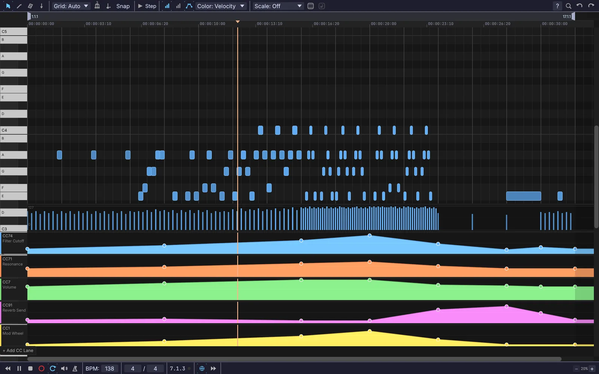</a></td>
    <td width="33%"><a href="https://kinematic.org/play/picture/">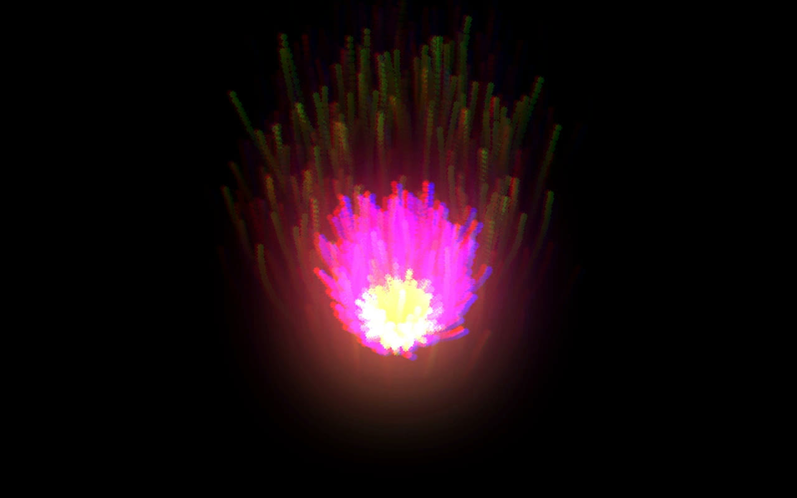</a></td>
  </tr>
  <tr>
    <td><sub>A keyboard synth on a panel: waveform, cutoff, attack and release, with a scope and spectrum.</sub></td>
    <td><sub>A melody in the piano roll with five colored CC lanes under it.</sub></td>
    <td><sub>Particles driven by a song. The loudness sets how many fly and each hit shakes them. Click for the video.</sub></td>
  </tr>
</table>

## New in 0.5.0

Kinematic is the new name, and you can now model, sculpt, paint and edit in the viewport.

- **Modeling in the viewport.** Extrude, inset, bevel, loop cut, knife, bridge, booleans. Each tool adds its node to the graph for you.
- **Sculpt, retopo, bake.** Pen pressure and tilt, layers, masks, face sets. Draw a clean mesh over your sculpt and bake the detail onto it.
- **UVs and texture paint.** Unwrap, relax, stitch, UDIMs. Paint color, roughness, metal and height in layers.
- **A timeline on every graph.** Play, scrub, loop and add markers. Scrub back through a simulation. Sync to MIDI clock or timecode.
- **Photo editing.** Crop, develop, curves, select subject or sky, paint, clone, heal, liquify.
- **Sound editing.** Trim, fade, EQ, clean noise and normalize a clip, with takes and markers.

[What's new in 0.5.0](https://kinematic.org/whats-new/) · [Full release notes](https://kinematic.org/changelog/#v0-5-0) · [All releases](https://kinematic.org/changelog/)

## Showreel

<p align="center">
  <a href="https://www.youtube.com/watch?v=JXA2xRo9f88"></a><br>
  <sub>Recorded before 0.5.0, when the app was still called OGEX.</sub>
</p>

## Make it yours

Python is built in, so scripts and extensions work with nothing else to install. Write your own nodes, panels and tools, or WGSL and GLSL shaders for pictures, materials and geometry. Run graphs from the command line too:

```
kinematic show.kin --kiosk --restart-on-panic 5
```

See [Developers](https://kinematic.org/developers/) and [Works with](https://kinematic.org/works-with/) for the files, protocols, gear and apps Kinematic talks to.

## Help and community

- **Stuck installing, or found a bug?** Run `kinematic report show.kin`. It gathers your version, your system details, the graph and the latest log into one folder you can look at before you send it. In the app, open Help, then Report a Bug.
- **Share what you made, ask a question, or reach out:** [Community](https://kinematic.org/community/)
- **Give more of your time** as an artist, tester, teacher or organizer: [Volunteer](https://kinematic.org/volunteer/)
- **Why it exists and who makes it:** [About](https://kinematic.org/about/)

Website: [kinematic.org](https://kinematic.org)
